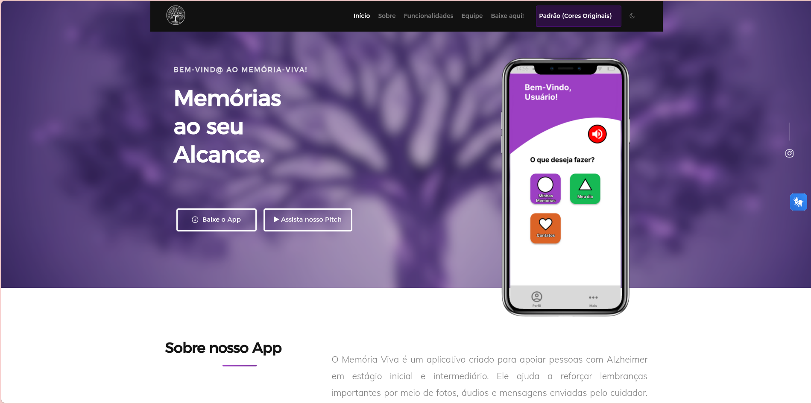

# Memória Viva - Website Oficial

Site desenvolvido como parte do projeto de TCC para apresentar o aplicativo **Memória Viva**, explicar a proposta e disponibilizar o download.

O Memória Viva é um aplicativo criado para apoiar pessoas com Alzheimer em estágio inicial e intermediário. Ele ajuda a reforçar lembranças importantes por meio de fotos, áudios e mensagens enviadas pelo cuidador.

O site funciona como a página oficial do projeto e reúne os objetivos, as funcionalidades e o impacto do aplicativo.

**Acesse:** https://manuellasantos.github.io/website-memoria-viva/

## Prévia



## Tecnologias utilizadas


O layout é responsivo e se adapta a celulares, tablets e computadores. O versionamento foi feito com Git e GitHub, e o site está publicado com o GitHub Pages.

## Objetivos do site

- Apresentar o aplicativo Memória Viva e a importância da proposta.
- Mostrar as funcionalidades do app de forma clara e visual.
- Disponibilizar o download do aplicativo.
- Organizar as informações do TCC de forma objetiva e fácil de navegar.

## O que o site tem

A página inicial é uma página única, dividida em seções com menu de navegação:

- **Início:** apresentação do projeto e botão de download.
- **Sobre:** explicação sobre o aplicativo.
- **Funcionalidades:** o que o app oferece, com imagens das telas.
- **Equipe:** os integrantes do projeto.
- **Baixe aqui:** download do APK para Android e acesso à versão web para iOS.

Além disso, o site tem:

- Modos de cor para acessibilidade: padrão, protanopia, deuteranopia, tritanopia e acromatopsia.
- Formulário e informações de contato.
- Páginas de perguntas frequentes (FAQ), termos de uso, política de privacidade e instruções para excluir a conta.

## Como rodar

Baixe ou clone o repositório e abra o arquivo `index.html` no navegador. Não é preciso instalar nada.

```bash
git clone https://github.com/manuellasantos/website-memoria-viva.git
```

Se preferir, use a extensão Live Server do VS Code para abrir o site e ver as alterações ao salvar.

## Download do aplicativo

- **Android:** APK disponível pelo botão de download do site.

## Equipe de desenvolvimento

| Nome | Função | Contribuições |
|---|---|---|
| Manuella Santos Cruz | Líder de Projeto, Front-End e Back-End | Layout, estrutura das páginas, organização do conteúdo e contribuições no back-end |
| Matheus Bonfim Batista | Engenheiro de Dados e assistente no site | Organização das informações técnicas e revisão estrutural |
| Fernanda Marques | Back-End e UI/UX Designer | Identidade visual, design responsivo e experiência do usuário |
